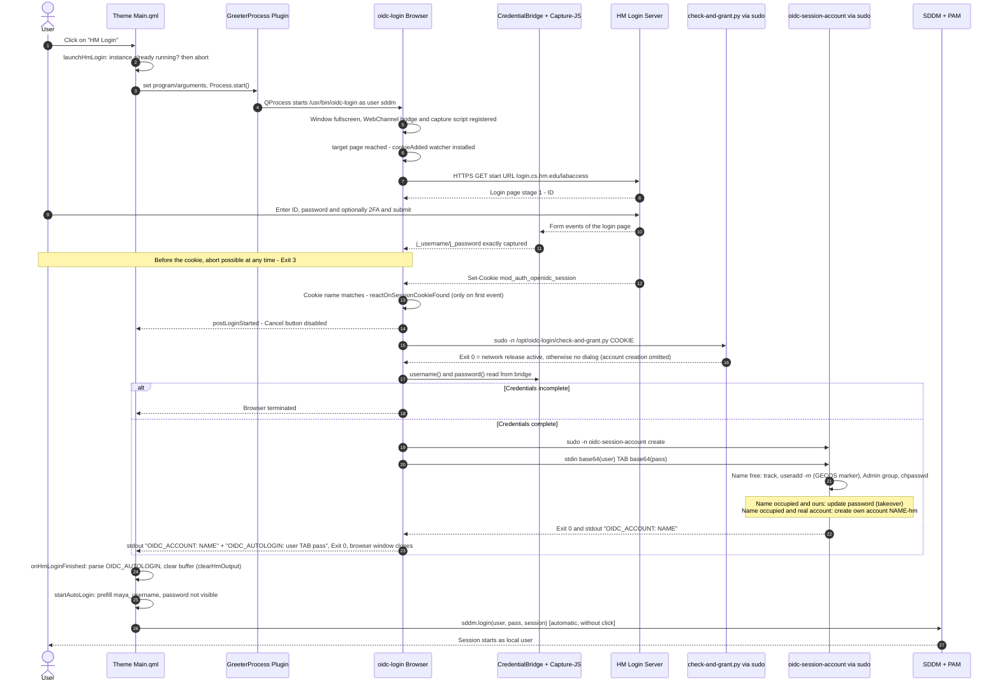

# SDDM Greeter with HM Login (oidc-login)

Extension of the SDDM Greeter with a “HM Login” button.
This starts the web browser `oidc-login`, which performs
the OIDC login against `https://login.cs.hm.edu/labaccess`.

After successful login the following happens:
1. Network/Root release: `sudo /opt/oidc-login/check-and-grant.py <cookie>`
   enables network access and root privileges. *If the
   script is not present on the system, this step is skipped.*
2. Session Admin Account: The HM credentials (username + password) used in the
   login form are captured and a local account with sudo rights is created.
   The user logs into the Greeter with this account. The account will be connected to LRZ Cloud Storage and get the OIDC cookies from the login process copied to Firefox.

The account can be configured as temporary via config. It then does:
- Logout → PAM hook deletes the account (including home directory).
- Crash/restart without logout → Boot cleanup (`Xsetup`) removes all remnants.

## Installation

Generally: SDDM must be installed (it is standard on KDE; otherwise e.g. `sudo apt install sddm`). Only then does `install.sh` run correctly.

The QML plugin is built against the Qt version of the SDDM Greeter. Which Qt packages you need depends on your
distribution version:

**Qt5 Greeter (e.g. Ubuntu ≤ 24.04)** (Plugin = Qt5, Browser `oidc-login` = Qt6 → both needed):

```bash
# Build tools (one time)
sudo apt install build-essential cmake pkg-config \
                 qtbase5-dev qtdeclarative5-dev \
                 qt6-base-dev qt6-webengine-dev qt6-webchannel-dev \
                 qt6-tools-dev qt6-l10n-tools \
                 libxkbfile-dev libxkbcommon-dev xkb-data
```

**Debian 13 trixie / Ubuntu ≥ 25.10 / 26 – SDDM Greeter is Qt6** (Plugin = Qt6, Browser = Qt6 → only Qt6 needed):

```bash
# Build tools (one time)
sudo apt install build-essential cmake pkg-config \
                 qt6-base-dev qt6-declarative-dev \
                 qt6-webengine-dev qt6-webchannel-dev \
                 qt6-tools-dev qt6-l10n-tools \
                 libxkbfile-dev libxkbcommon-dev xkb-data
```

**Fedora 40+ / RHEL 9+ – SDDM Greeter is Qt6**:

```bash
# Build tools (one time)
sudo dnf install gcc-c++ cmake pkgconfig \
                 qt6-qtbase-devel qt6-qtdeclarative-devel \
                 qt6-qtwebengine-devel qt6-qtwebchannel-devel qt6-qttools-devel \
                 libxkbfile-devel libxkbcommon-devel
```

Then build and install:

```bash
# Build theme + plugin + session account helper, install and activate
sudo ./install.sh
```

`install.sh` does the following:
1. detects the Qt version of the SDDM Greeter and builds the QML plugin `GreeterProcess` with this version,
2. installs it to `$(qmake -query QT_INSTALL_QML)/GreeterProcess`,
3. copies the theme to `/usr/share/sddm/themes/maya-hm`,
4. builds `oidc-login` and installs it to `/usr/bin/oidc-login`,
5. activates the theme via `/etc/sddm.conf.d/99-maya-hm.conf`,
6. installs `oidc-session-account` and `oidc-session-cleanup` to `/usr/local/sbin`,
7. creates the sudoers rules for user `sddm`,
8. adds the PAM logout hook to the SDDM PAM services,
9. creates the tracking directory `/etc/oidc-login/` and the config,
10. installs the SSO cookie helper and the LRZ network drive helper,
11. ensures the Gio/GVFS stack for the network drive.

Options: `--qt 5|6` (force Qt variant, e.g. `sudo ./install.sh --qt 6`) and `--uninstall` (removes everything and
restores the previous display manager).

## Configuration File: `/etc/oidc-login/oidc-login.conf`

All relevant variables are in this config file. Configure and run install.sh.

## OIDC Account Creation Behaviour

| Situation | Behaviour |
|-----------|-----------|
| Name free | Tracked, `useradd -m` (GECOS marker), Admin group, `chpasswd` |
| Name exists as tracked session account | Takeover: password updated, SSO cookies refreshed |
| Name exists as real account (not tracked by us) | session account created as `<name>-hm` (then `<name>-hm2`, … up to `<name>-hm20`) |

## Account Removal
`delete-user` deletes only tracked session accounts (account, home, tracking
entry); `cleanup-all` does that for all at once and keeps persistent
accounts (`OIDC_SESSION_TEMPORARY=false`) – use `cleanup-all --force` to delete
those too.

```bash
sudo /usr/local/sbin/oidc-session-account delete-user k12345
sudo /usr/local/sbin/oidc-session-account cleanup-all           # keeps persistent
sudo /usr/local/sbin/oidc-session-account cleanup-all --force   # deletes all
```

Running sessions and not tracked accounts remain untouched.

## Directories

| Path                                   | Content                                              |
|----------------------------------------|-----------------------------------------------------|
| `sddm-theme/`                          | Theme maya-hm  |
| `greeter-process/`                     | Qt5-/Qt6-QML-Plugin |
| `session-account/`                     | Root scripts  |
| `selinux/`                             | SELinux policy for Fedora |
| `oidc-login/`                          | The browser application          |
| `cloud-mount/`                         | Helper: maps LRZ Cloud Storage as network drive |
| `sso-cookie/`                          | Helper: imports SSO cookies spoofed during HM login into Firefox |
| `install.sh`                           | Build + Installation + Activation                  |

## Flow: HM Login and Account Creation (Sequence Diagram)

From clicking “HM Login” to the finished session account.

